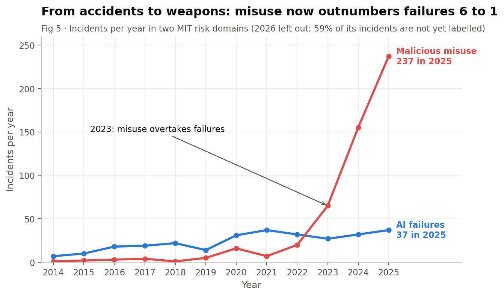

# From Accidents to Weapons

A statistical analysis of 1,711 AI incidents from the [AI Incident Database](https://incidentdatabase.ai/) (1983 – 2026).

**Question:** for most of AI's history, AI hurt people by accident (a self-driving car missed a pedestrian, a biased model denied a loan). Is that still true, or is AI now mostly a tool people use to harm each other on purpose?

Course project for **Data Science Essentials**, B.Tech CSE Semester 7 — Poushikan R (2301107074), Section B.



## Research questions

| # | Question | Method |
|---|---|---|
| RQ1 | How fast are AI incidents growing? | Descriptive statistics, linear vs exponential trend regression |
| RQ2 | Is harm shifting from accidental failures to deliberate misuse? | Percentage comparison by era, trend line on yearly share, logistic regression |
| RQ3 | Does the incident text separate into the same risk categories the experts assigned? | TF-IDF + K-Means clustering, purity / ARI / NMI |
| RQ4 | Can a model tell from the description whether harm was intentional? | TF-IDF + Logistic Regression classifier |

## Key findings

- **Incidents grow exponentially:** about +41% per year (doubling every ~2 years), and faster since 2021. The exponential model fits far better than a straight line (R² 0.97 vs 0.645).
- **Harm has shifted to deliberate misuse:** the intentional share rose from 24% (before 2018) to 65% (2025). Logistic regression gives an odds ratio of 1.23 per year, crossing 50% around 2022–23.
- **Misuse overtook AI failures in 2023**, and by 2025 it was over 6× larger (237 vs 37 incidents).
- **The text tells the same story:** with no labels, K-Means finds "weapon" clusters (deepfakes, scams, political fake media) that are over 90% intentional and "accident" clusters (self-driving, chatbot errors) that are mostly unintentional.
- **Intent can be predicted from text:** about 80% accuracy against a 50% baseline. Filling in the unlabelled incidents with predictions does not change the trend.

Hypothesis *"AI harm is shifting from accidental failure to deliberate misuse"*: **supported**.

## Repository structure

```
data/        AIID Excel export (05-Oct-2026)
doc/         project abstract / proposal
notebooks/   AI_Incidents_Analysis.ipynb - the full analysis
outputs/
  figures/   the 13 report figures (PNG)
  tables/    data behind each figure (CSV)
  results.json   numbers quoted in the report
```

## How to run

1. Install Python 3.10+ and the libraries:
   ```
   pip install numpy pandas matplotlib seaborn scipy statsmodels scikit-learn openpyxl jupyter
   ```
2. Open `notebooks/AI_Incidents_Analysis.ipynb` from inside the `notebooks/` folder (the data is read from `../data/`).
3. Run all cells. All 13 charts are shown inline.

The clustering results (RQ3) can differ slightly between scikit-learn versions; the figures and tables in `outputs/` were produced with scikit-learn 1.2.2.

## Limitations

- The database only contains *reported* incidents, so media attention and reporting bias shape it.
- About 13% of incidents have no MIT risk labels.
- 2026 is a partial year (data ends 5 Oct 2026) and is affected by reporting lag, so it is left out of trend fits.
- These are associations, not causal effects.

## Data source

AI Incident Database (AIID), Responsible AI Collaborative — Excel export dated 05-Oct-2026, using the MIT AI Risk Repository, CSETv1 and GMF taxonomies.
